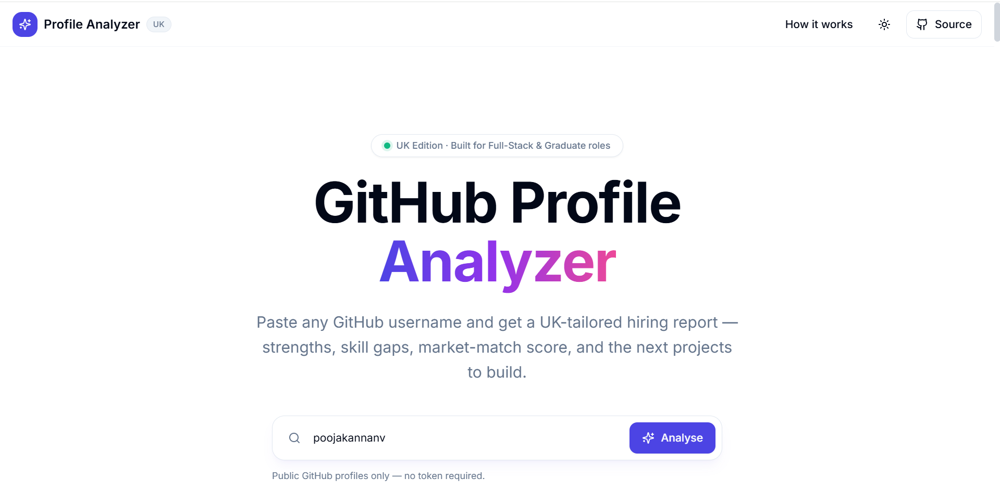
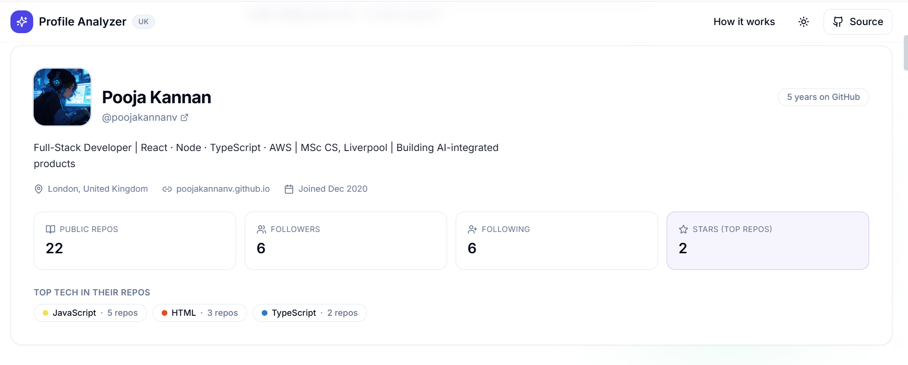
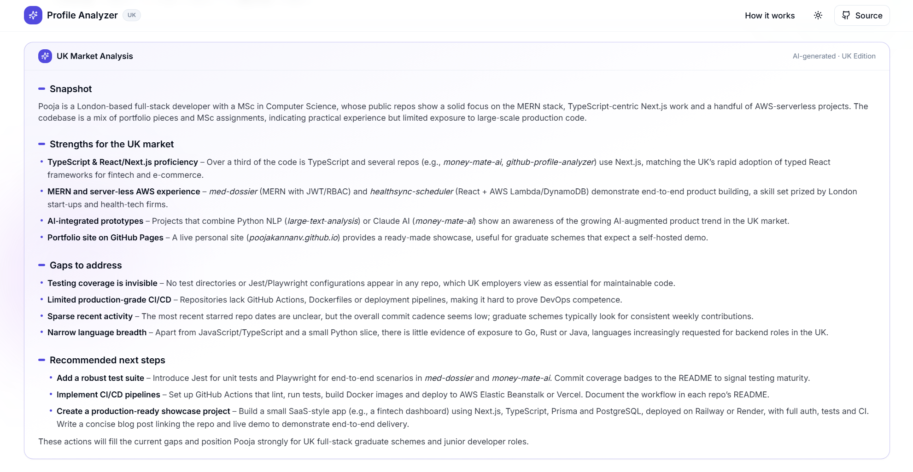
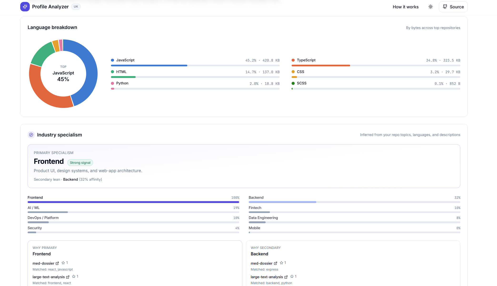

# GitHub Profile Analyzer 🇬🇧

> The only GitHub profile analyzer built specifically for the **UK job market**.
> Paste any GitHub username and get a UK-tailored hiring report — visa-sponsor matches, graduate scheme fit, salary band, industry specialism, and a ready-to-paste LinkedIn summary.

[](https://www.typescriptlang.org/)
[](https://nextjs.org/)
[](https://tailwindcss.com/)
[](./LICENSE)
[](https://github-profile-analyzer-blush.vercel.app)

**🔗 Live demo: [github-profile-analyzer-blush.vercel.app](https://github-profile-analyzer-blush.vercel.app)**

## 📸 Screenshots

| Landing | Profile card |
|---|---|
|  |  |

| UK Market Analysis (AI) | Language breakdown and industry specialism |
|---|---|
|  |  |

## 🇬🇧 Why this is different

Every other GitHub profile analyzer is generic and global. This one is **purpose-built for the UK**:

| Feature | What it does | Why it's unique |
|---|---|---|
| 🛂 **Visa Sponsor Match** | Maps your stack to UK Skilled Worker visa sponsors (Revolut, Monzo, GCHQ, BAE, Capgemini, etc.) | The single biggest question for international developers in the UK |
| 🎓 **Graduate Scheme Matcher** | Scores against PwC, KPMG, JPMorgan, Goldman, Accenture, NHS Digital, BAE programmes | UK has a unique grad-scheme culture — generic tools ignore it |
| 💷 **UK Salary Band Estimate** | Rough £ range by role + location (London / Manchester / remote-UK) | Concrete goalpost in £, not vague "good" / "needs work" |
| 🏦 **Industry Specialism Detector** | Detects Fintech (Open Banking, Stripe, FCA), GovTech (gov.uk, NHS FHIR), Healthtech signals from repos | The UK's three biggest growth engines for developers |
| 💼 **LinkedIn Summary Generator** | AI generates a UK-English LinkedIn About section optimised for UK recruiter keywords | UK English, UK norms, visa/location flexibility callouts |

Plus the standard analyzer features:

- **Profile Summary** — AI-generated narrative of strengths
- **Tech Stack Breakdown** — real-data language proficiency chart
- **Top Projects** — most-starred repos with quality signals
- **UK Match Score** — 0–100 alignment with current UK Full-Stack / Graduate demand
- **Skill Gap Analysis** — what to learn next based on UK job postings
- **Suggested Next Projects** — AI ideas to fill the gaps
- **PDF export + share card** — export the full report as a PDF; links unfurl with a generated Open Graph image

## 🛠️ Tech Stack

| Layer | Choice | Why |
|---|---|---|
| Framework | Next.js 14 (App Router) | Full-stack React, deploys easily on Vercel |
| Language | TypeScript | Type-safety, UK employer expectation |
| Styling | Tailwind CSS + shadcn/ui | Rapid, modern, professional |
| GitHub API | Octokit (REST) | Official, well-typed |
| AI | OpenAI-compatible (Groq, OpenAI, Together, etc.) | LLM-generated insights — provider-agnostic |
| Charts | Recharts | Language breakdown visualisation |
| Deploy | Vercel | Free tier, GitHub integration |

## 🚀 Quick Start

```bash
# Install
npm install

# Set up environment
cp .env.example .env.local
# Add GITHUB_TOKEN (optional but recommended)
# Add your AI provider key (Groq free tier recommended — see .env.example)

# Run dev server
npm run dev
```

Open [http://localhost:3000](http://localhost:3000).

## 📅 Daily Commit Roadmap

This project is built in **28 daily commits** of 30–60 mins each, ending in a deployed app. See [`DAILY_ROADMAP.md`](./DAILY_ROADMAP.md) for the day-by-day plan.

- **Week 1 — Foundation:** Next.js, shadcn/ui, GitHub API integration
- **Week 2 — Analysis & Viz:** Language charts, repo grid, AI summary
- **Week 3 — 🇬🇧 UK Superpowers:** Visa, grad schemes, salary, industry, LinkedIn
- **Week 4 — Polish & Deploy:** OG image, PDF export, Typed.js, deploy

## 📂 Project Structure

```
github-profile-analyzer/
├── app/                      # Next.js App Router
│   ├── layout.tsx            # Fonts, metadata, theme bootstrap
│   ├── page.tsx              # Landing + analyzer, JSON-LD
│   ├── globals.css           # Design tokens, print stylesheet
│   ├── opengraph-image.tsx   # Generated share card
│   ├── sitemap.ts / robots.ts
│   └── api/analyze/          # GitHub + AI analysis endpoint
├── components/
│   ├── Hero.tsx, TypedTagline.tsx, SearchForm.tsx
│   ├── AnalyzeSection.tsx    # Search -> fetch -> report flow
│   ├── ProfileCard.tsx, AiSummary.tsx
│   ├── LanguageBreakdown.tsx, LanguageChart.tsx
│   ├── VisaSponsorMatch.tsx     # 🇬🇧
│   ├── GradSchemeMatcher.tsx    # 🇬🇧
│   ├── SalaryBand.tsx           # 🇬🇧
│   ├── IndustrySpecialism.tsx   # 🇬🇧
│   ├── SkillGap.tsx             # 🇬🇧
│   ├── LinkedInSummary.tsx      # 🇬🇧
│   ├── ExportPdfButton.tsx, ThemeToggle.tsx, Toaster.tsx
│   └── ui/                   # shadcn/ui primitives
├── lib/
│   ├── github.ts             # Octokit wrappers
│   ├── ai.ts                 # LLM analysis (OpenAI-compatible)
│   ├── errors.ts             # Client-side error taxonomy
│   ├── site.ts               # Canonical URL and site copy
│   ├── uk-sponsors.ts        # 🇬🇧 Visa sponsors by stack
│   ├── uk-grad-schemes.ts    # 🇬🇧 Graduate scheme criteria
│   ├── uk-salary.ts          # 🇬🇧 Salary bands by role + location
│   ├── uk-industries.ts      # 🇬🇧 Industry detection patterns
│   ├── uk-skills.ts          # 🇬🇧 UK skill demand weights
│   └── linkedin-summary.ts   # 🇬🇧 LinkedIn headline + About builder
├── types/                    # TypeScript types
└── docs/screenshots/         # README images
```

## 📜 Licence

MIT
